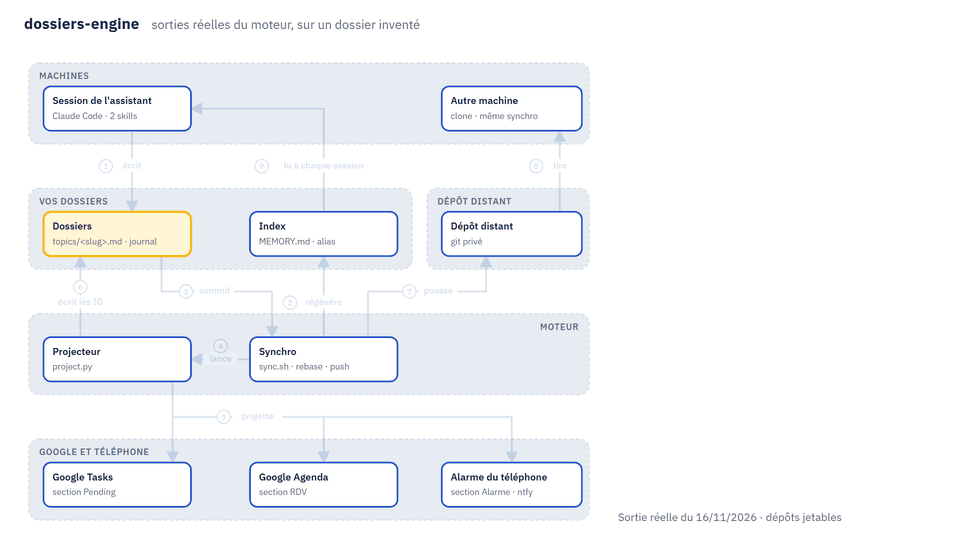

[English](README.md) · **Français**

# dossiers-engine

**Un fichier Markdown par sujet, dans un dépôt git, sert de mémoire longue à un assistant d'IA.** Une synchro tient chaque machine à jour.


<details><summary>Version française</summary>



</details>

*Sorties réelles sur des dépôts jetables, avec un dossier inventé ; projecteur à blanc, sans compte Google.*

## Utilisation

- **Écrire.** Le skill `update-dossier` modifie `topics/<slug>.md` : état actuel, journal daté, actions, rendez-vous, alarmes.
- **Retrouver.** `MEMORY.md`, une ligne par dossier avec des alias en langage courant, est généré à partir des en-têtes et chargé au début de chaque session : « ouvre le dossier de la fête du quartier » mène au bon fichier sans recherche.
- **Projeter.** Les lignes de `## Pending`, `## RDV` et `## Alarme` deviennent tâches Google, événements d'agenda et alarmes du téléphone. Les identifiants sont écrits en retour à côté de chaque ligne : rien n'est créé deux fois. Sous cron ou systemd, au plus toutes les 9 minutes.
- **Synchroniser.** `scripts/sync.sh` commite, rebase, remet les en-têtes au format, refait l'index, projette et pousse. Un vrai conflit laisse un fichier `.sync_broken` au lieu d'échouer en silence.
- **Rester privé.** Le moteur est public, vos dossiers non : gardez-les dans votre propre dépôt privé. Des exemples inventés sont dans `examples/` ; la méthode est dans `docs/methode.md`.

## Architecture


<details><summary>Diagramme en français</summary>


</details>

## Démarrage

```bash
python3 -m pip install PyYAML
mkdir -p ~/mes-dossiers/{topics,journal} && git -C ~/mes-dossiers init -b main
cp examples/topics/*.md ~/mes-dossiers/topics/ && cp examples/journal/*.md ~/mes-dossiers/journal/
export DOSSIERS_DIR=~/mes-dossiers
python3 scripts/gen-index.py                     # écrit MEMORY.md
python3 scripts/projector/project.py --dry-run   # montre ce qui serait créé, sans compte Google
python3 -m unittest discover -s tests
```

<details><summary>Google, synchro, alarmes et skills</summary>

- **Google.** `pip install -r scripts/projector/requirements.txt`, un projet Google Cloud avec les API Tasks et Calendar et un client OAuth *Desktop app*, puis une fois `python3 scripts/projector/autoriser.py client_secret.json`. Les tâches vont dans la liste nommée par `tasklist:` dans l'en-tête du dossier.
- **Synchro.** Ajouter un dépôt distant privé, puis lancer `DOSSIERS_PROJECTEUR_PYTHON=$(which python3) bash scripts/sync.sh` chaque minute par cron (`DOSSIERS_CRON=1`) ou un minuteur systemd.
- **Alarmes.** `DOSSIERS_ALARM_CMD` désigne la commande qui fait sonner le téléphone : `scripts/alarme-ntfy.sh` avec un serveur [ntfy](https://docs.ntfy.sh) (`scripts/ntfy-server/`), ou la vôtre.
- **Skills.** Copier `skills/update-dossier` et `skills/open-dossier` dans `~/.claude/skills/` et importer `MEMORY.md` depuis votre `CLAUDE.md` ([Claude Code](https://code.claude.com/docs/en/overview)).

Prérequis : Linux ou macOS, `bash`, `git`, Python 3.10 ou plus récent. Autres réglages : `DOSSIERS_STATE`, `DOSSIERS_TZ`, `DOSSIERS_GOOGLE_TOKEN`, `NTFY_ENV`.

</details>

## Exploitation

- **Depuis juin 2026** comme mémoire de l'auteur : 236 dossiers, environ 5 700 commits, trois machines sur un même dépôt privé.
- **Synchro plus stricte.** L'auteur fait tourner une variante non publiée : un commit par dossier, fusions refusées par un hook du serveur, un passage toutes les 30 secondes et après chaque push.
- **Alarmes.** Elles sonnent par une appli d'automatisation du téléphone plutôt que par ntfy, branchée par `DOSSIERS_ALARM_CMD`.
- **Licences.** Code sous Apache 2.0 (`LICENSE`, `NOTICE`) ; documentation, exemples et skills sous CC BY 4.0 (`LICENSE-docs`).

---

**Anthony Hunt** · [ingevision.cloud](https://ingevision.cloud/?p=dossiers) · [LinkedIn](https://www.linkedin.com/in/anthony-hunt-3948a9196) · [GitHub](https://github.com/anthohunt)
