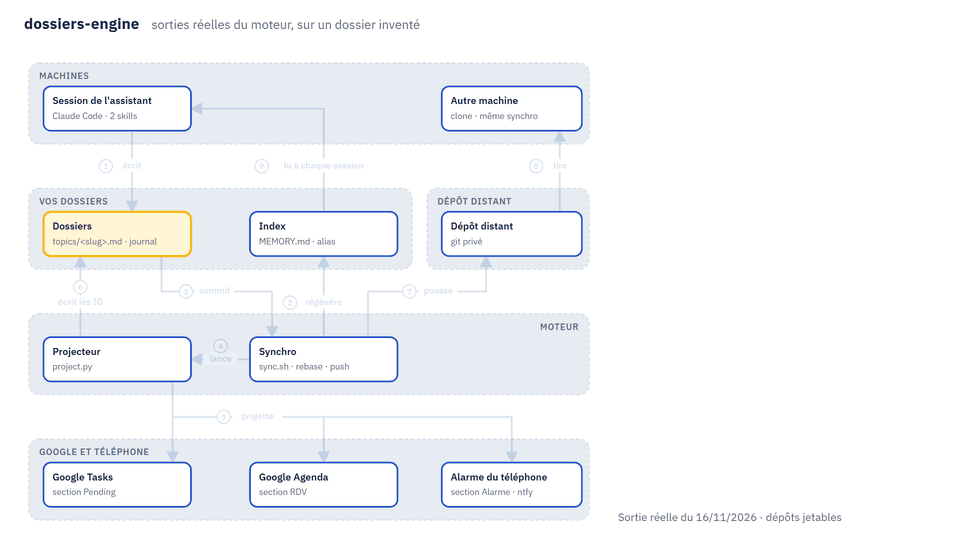

**English** · [Français](README.fr.md)

# dossiers-engine

**One Markdown file per subject, in a git repository, is an AI assistant's long-term memory.** A sync loop keeps every machine up to date.

[](https://drive.google.com/file/d/1TD0ZpmaiLV1dK_TgPJ7qHXy2XrjrxHXu/view)

*Real outputs from throwaway repositories, on an invented dossier; projector in dry-run, no Google account. [Full video (1:14)](https://drive.google.com/file/d/1TD0ZpmaiLV1dK_TgPJ7qHXy2XrjrxHXu/view)*

## Using it

- **Write.** The `update-dossier` skill edits `topics/<slug>.md`: current state, dated journal, actions, appointments, alarms.
- **Find.** `MEMORY.md`, one line per dossier with natural-name aliases, is generated from the headers and loaded at the start of each session; "open the street party dossier" lands on the right file without a search.
- **Project.** Lines under `## Pending`, `## RDV` and `## Alarme` become Google Tasks, Calendar events and phone alarms. The IDs are written back next to each line, so nothing is created twice. Under cron or systemd, at most every 9 minutes.
- **Sync.** `scripts/sync.sh` commits, rebases, normalises headers, rebuilds the index, projects and pushes. A real conflict leaves a `.sync_broken` file instead of failing silently.
- **Stay private.** The engine is public, your dossiers are not: keep them in your own private repository. Invented examples are in `examples/`; the method is in `docs/methode.md`.

## Architecture


<details><summary>French version</summary>


</details>

## Quick start

```bash
python3 -m pip install PyYAML
mkdir -p ~/my-dossiers/{topics,journal} && git -C ~/my-dossiers init -b main
cp examples/topics/*.md ~/my-dossiers/topics/ && cp examples/journal/*.md ~/my-dossiers/journal/
export DOSSIERS_DIR=~/my-dossiers
python3 scripts/gen-index.py                     # writes MEMORY.md
python3 scripts/projector/project.py --dry-run   # shows what would be created, no Google account needed
python3 -m unittest discover -s tests
```

<details><summary>Google, sync, alarms and skills</summary>

- **Google.** `pip install -r scripts/projector/requirements.txt`, a Google Cloud project with the Tasks and Calendar APIs and a *Desktop app* OAuth client, then `python3 scripts/projector/autoriser.py client_secret.json` once. Tasks go to the list named by `tasklist:` in a dossier's header.
- **Sync.** Add a private remote, then run `DOSSIERS_PROJECTEUR_PYTHON=$(which python3) bash scripts/sync.sh` from cron every minute (`DOSSIERS_CRON=1`) or a systemd timer.
- **Alarms.** `DOSSIERS_ALARM_CMD` names the command that rings the phone: `scripts/alarme-ntfy.sh` with a [ntfy](https://docs.ntfy.sh) server (`scripts/ntfy-server/`), or your own.
- **Skills.** Copy `skills/update-dossier` and `skills/open-dossier` into `~/.claude/skills/` and import `MEMORY.md` from your `CLAUDE.md` ([Claude Code](https://code.claude.com/docs/en/overview)).

Requirements: Linux or macOS, `bash`, `git`, Python 3.10 or later. Other settings: `DOSSIERS_STATE`, `DOSSIERS_TZ`, `DOSSIERS_GOOGLE_TOKEN`, `NTFY_ENV`.

</details>

## Deployment

- **Since June 2026** as the author's own memory: 236 dossiers, about 5,700 commits, three machines on one private repository.
- **Stricter sync.** The author runs an unpublished variant: one commit per dossier, merges refused by a server hook, a run every 30 seconds and after each push.
- **Alarms.** They ring through a phone automation app rather than ntfy, plugged in with `DOSSIERS_ALARM_CMD`.
- **Licenses.** Code under Apache 2.0 (`LICENSE`, `NOTICE`); documentation, examples and skills under CC BY 4.0 (`LICENSE-docs`).

---

**Anthony Hunt** · [ingevision.cloud](https://ingevision.cloud/?lang=en&p=dossiers) · [LinkedIn](https://www.linkedin.com/in/anthony-hunt-3948a9196) · [GitHub](https://github.com/anthohunt)
